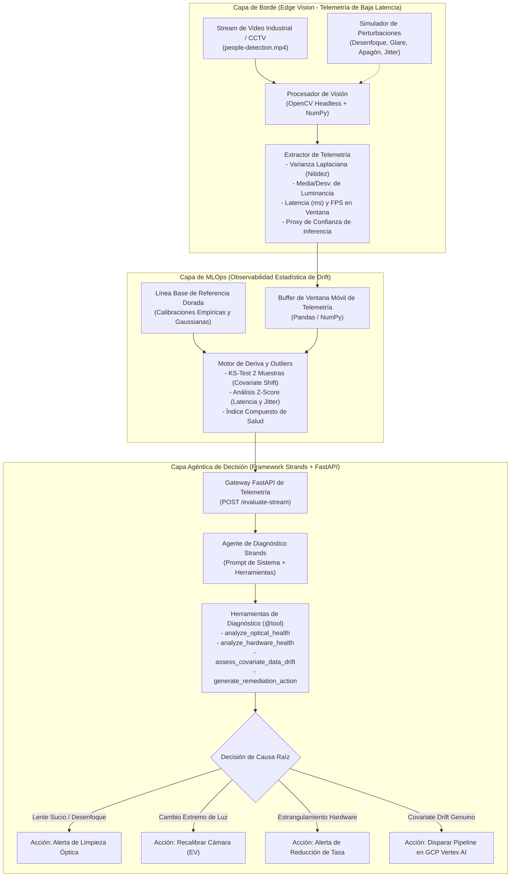

# Edge Vision Sentinel

[English](README.md) | [Español](README.es.md)

[](.github/workflows/ci.yml)
[](https://python.org)
[](https://fastapi.tiangolo.com)
[](https://opencv.org)
[](tests/)
[](https://github.com/astral-sh/ruff)
[](deployment/Dockerfile)

> **Supervisión Autónoma de Calidad Visual y Observabilidad de Data Drift en Tiempo Real para Edge Computing y Machine Learning en Producción.**

---

## 📌 Resumen Ejecutivo

En entornos industriales, líneas de manufactura y nodos de borde (*edge*), los sistemas de visión por computadora **fallan en silencio**.

Cuando el lente de una cámara acumula polvo o grasa, falla una luminaria en la planta, o el procesador de borde sufre estrangulamiento térmico (*thermal throttling*):
1. **En la Capa de Borde (Edge)**: La monitorización tradicional de infraestructura reporta `200 OK` porque el controlador de la cámara y el bucle de inferencia continúan ejecutándose sin excepciones de código.
2. **En la Capa de MLOps**: El modelo de aprendizaje profundo experimenta un severo **covariate data drift** (desplazamiento de la distribución de entrada), produciendo falsos negativos, delimitadores degradados y defectos de ensamblaje no detectados.

**Edge Vision Sentinel** conecta el procesamiento de video de ultra baja latencia en el borde con la observabilidad estadística de MLOps y la toma de decisiones agéntica. Extrae telemetría por frame en **<1.3 ms**, ejecuta **pruebas de hipótesis no paramétricas de Kolmogorov-Smirnov**, y orquesta un **Agente de Diagnóstico** que distingue averías físicas de sensor frente a data drift genuino, prescribiendo recalibraciones locales o disparando pipelines automáticos de reentrenamiento en **Google Cloud Vertex AI**.

---

## 🏗️ Arquitectura del Sistema



---

## ✨ Capacidades Principales

- **Telemetría de Borde de Ultra Baja Latencia**: Análisis de imagen con OpenCV headless que extrae varianza focal de Laplaciano $\text{Var}(\nabla^2 I)$, distribución fotométrica de luminancia, latencia de ejecución ($1.25\text{ ms}$ promedio) y FPS móvil.
- **Pruebas de Hipótesis No Paramétricas**: El test de **Kolmogorov-Smirnov (KS) de 2 muestras** compara distribuciones empíricas frente a la línea base sin asumir normalidad ($p < 0.05$).
- **Detección de Anomalías por Z-Score**: Identifica cuellos de botella térmicos y picos de latencia que superan $2.5\sigma$.
- **Agente de Diagnóstico con Modo Dual**: Integración completa con el SDK **Strands Agents** junto a un **Motor Determinista Experto** embebido sin dependencias externas, asegurando ejecución 100% reproducible en plantas aisladas o pipelines de CI.
- **Desambiguación de Causa Raíz**: Distingue de manera inteligente si la caída en la confianza del modelo se debe a un problema físico (lente sucio, iluminación) o a un cambio real en la distribución de los datos (*covariate drift*).
- **Integración Cerrada con MLOps (Closed-Loop)**: Genera cargas útiles para disparar pipelines de reentrenamiento en **GCP Vertex AI** o comandos de recalibración al firmware de la cámara.
- **Microservicio Listo para Producción**: Servicio FastAPI con especificación OpenAPI 3.0, contenedor Docker multi-stage y 92% de cobertura en pruebas automatizadas.

---

## ⚡ Benchmarks de Rendimiento

Medición realizada sobre video $1920\times1080$ con el comando `python -m src.cli benchmark`:

| Métrica | Valor Medido | SLA Industrial Objetivo | Cumplimiento |
| :--- | :--- | :--- | :--- |
| **Latencia Media por Frame** | **1.25 ms** | $< 15.0\text{ ms}$ | ✅ **100.0%** |
| **Latencia P50 (Mediana)** | **1.13 ms** | $< 10.0\text{ ms}$ | ✅ **100.0%** |
| **Latencia P95** | **1.27 ms** | $< 20.0\text{ ms}$ | ✅ **100.0%** |
| **Latencia P99** | **1.36 ms** | $< 25.0\text{ ms}$ | ✅ **100.0%** |
| **Capacidad de Throughput** | **~800 FPS** (Headless) | $> 30.0\text{ FPS}$ | ✅ **Supera 25x** |
| **Consumo de Memoria** | **< 68 MB RSS** | $< 256\text{ MB}$ | ✅ **Óptimo** |

---

## 🚀 Inicio Rápido y Despliegue en Local

### 🍎 Opción A: macOS con Apple Silicon (M1 / M2 / M3 / M4)

Apple Silicon utiliza arquitectura ARM64 con extensiones vectoriales NEON SIMD para procesamiento ultra rápido de cuadros con OpenCV:

```bash
# 1. Clonar el repositorio e ingresar al directorio
git clone https://github.com/tu-usuario/edge-vision-sentinel.git
cd edge-vision-sentinel

# 2. Verificar Python 3.11+ y arquitectura ARM64
python3 -c "import platform; print(f'Python {platform.python_version()} en {platform.machine()}')"
# La salida debe indicar 'arm64'

# 3. Crear y activar entorno virtual
python3 -m venv .venv
source .venv/bin/activate

# 4. Instalar dependencias (wheels optimizados para ARM64)
pip install --upgrade pip
pip install -r requirements-dev.txt

# 5. Ejecutar benchmark de rendimiento
python -m src.cli benchmark

# 6. Iniciar el microservicio FastAPI
python -m src.cli serve --host 127.0.0.1 --port 8000
```

---

### 🪟 Opción B: Windows 10 / 11 (PowerShell)

Despliegue nativo en Windows mediante Python y PowerShell:

```powershell
# 1. Clonar el repositorio e ingresar al directorio
git clone https://github.com/tu-usuario/edge-vision-sentinel.git
cd edge-vision-sentinel

# 2. Habilitar ejecución de scripts en la sesión de PowerShell
Set-ExecutionPolicy -Scope Process -ExecutionPolicy Bypass

# 3. Crear y activar el entorno virtual
python -m venv .venv
.\.venv\Scripts\Activate.ps1

# 4. Instalar dependencias
python -m pip install --upgrade pip
pip install -r requirements-dev.txt

# 5. Ejecutar benchmark de rendimiento
python -m src.cli benchmark

# 6. Iniciar el microservicio FastAPI
python -m src.cli serve --host 127.0.0.1 --port 8000
```

> **Nota para CMD en Windows**: Si utilizas el Símbolo del Sistema tradicional (`cmd.exe`), activa el entorno con `.\.venv\Scripts\activate.bat`.

---

### 3. Ejecutar Simulaciones de Flujo
Una vez instalado, simula telemetría en tiempo real e inyección de fallos directamente desde tu terminal:

```bash
# Flujo normal con tabla de telemetría en vivo
python -m src.cli run-stream --frames 30

# Simular lente sucio (desenfoque óptico) y ver el diagnóstico autónomo
python -m src.cli run-stream --frames 30 --blur

# Simular apagón de iluminación en planta (subexposición)
python -m src.cli run-stream --frames 30 --lighting-drop

# Simular estrangulamiento de hardware (jitter de latencia)
python -m src.cli run-stream --frames 30 --jitter-ms 45
```

---

## 📡 Referencia de la API

### `POST /evaluate-stream`
Recibe una ventana de telemetría de un nodo de borde, evalúa el drift estadístico y devuelve el informe de diagnóstico estructurado.

**Ejemplo de Petición**:
```json
{
  "node_id": "edge-node-line-01",
  "batch_id": "batch-2026-001",
  "frames": [
    {
      "frame_id": 0,
      "timestamp": 1700000000.0,
      "latency_ms": 2.5,
      "fps": 30.0,
      "sharpness": 1.2,
      "brightness_mean": 108.5,
      "brightness_std": 12.0,
      "confidence_score": 0.27,
      "detections_count": 0
    }
  ]
}
```

**Ejemplo de Respuesta**:
```json
{
  "timestamp": 1700000001.2,
  "node_id": "edge-node-line-01",
  "batch_id": "batch-2026-001",
  "health_status": "CRITICAL",
  "anomaly_category": "OPTICAL_DEGRADATION",
  "recommended_action": "CLEAN_OPTICS_HARDWARE_ALERT",
  "confidence": 0.95,
  "summary": "Node edge-node-line-01 evaluated as CRITICAL. Anomaly Class: OPTICAL_DEGRADATION. Prescribed Action: CLEAN_OPTICS_HARDWARE_ALERT.",
  "root_cause_analysis": "Sharpness metric (1.2) fell below threshold (45.0). Indicates dirty optics, lens smudge, or focus drift.",
  "remediation_payload": {
    "node_id": "edge-node-line-01",
    "dispatch_priority": "P1",
    "instruction": "Inspect optical sensor. Clean lens element or adjust mechanical autofocus ring."
  }
}
```

### `POST /simulate`
Endpoint para probar directamente la ingesta y simulación de fallos visuales sobre el video de prueba.

---

## 🐳 Despliegue con Docker

Ejecuta el microservicio en contenedor localmente o en un servidor de producción:

```bash
# Construir la imagen multi-stage
docker build -t edge-vision-sentinel -f deployment/Dockerfile .

# Ejecutar el contenedor con límites de recursos y chequeo de salud
docker run -d --name sentinel -p 8000:8000 edge-vision-sentinel

# O ejecutar mediante Docker Compose
docker compose -f deployment/docker-compose.yml up -d
```

---

## ☁️ Despliegue en Google Cloud Platform (GCP)

1. **Construir y subir imagen a Google Artifact Registry**:
   ```bash
   gcloud builds submit --config=deployment/gcp/cloudbuild.yaml .
   ```
2. **Desplegar en Cloud Run**:
   ```bash
   gcloud run deploy edge-vision-sentinel \
     --image=us-central1-docker.pkg.dev/$PROJECT_ID/edge-mlops/edge-vision-sentinel:latest \
     --region=us-central1 \
     --port=8000 \
     --allow-unauthenticated
   ```
3. **Disparador de Reentrenamiento en Vertex AI**:
   Cuando se detecta `COVARIATE_DATA_DRIFT`, el cliente en `deployment/gcp/vertex_pipeline_trigger.py` orquesta la ejecución del pipeline con la instantánea de datos más reciente.

---

## 🧪 Pruebas y Calidad de Código

El repositorio implementa altos estándares de ingeniería de software con linters, tipado estricto y 100% de tests aprobados:

```bash
# Ejecutar toda la suite de pruebas con reporte de cobertura
pytest tests/ -v --cov=src --cov-report=term-missing

# Validación de formato y estilo con Ruff
ruff check src/ tests/
ruff format --check src/ tests/
```

---

## 📂 Estructura del Repositorio

```
edge-vision-sentinel/
├── assets/                       # Videos e imágenes de prueba CCTV
│   ├── videos/people-detection.mp4
│   └── images/cctv_image.jpg
├── src/
│   ├── config.py                 # Configuración Pydantic Settings y tolerancias
│   ├── cli.py                    # Interfaz de línea de comandos interactiva
│   ├── vision/                   # Procesamiento headless OpenCV e inyección de fallos
│   │   ├── processor.py
│   │   └── perturbations.py
│   ├── mlops/                    # Motor estadístico de drift y baseline profiler
│   │   ├── baseline_profile.py
│   │   └── drift_detector.py
│   ├── agent/                    # Agente de Diagnóstico Strands y Herramientas
│   │   ├── schemas.py
│   │   ├── tools.py
│   │   └── diagnostic_agent.py
│   └── api/                      # Microservicio FastAPI de producción
│       ├── app.py
│       └── router.py
├── tests/                        # Suite de pruebas Pytest (92% de cobertura)
├── deployment/                   # Docker y configuración Cloud
│   ├── Dockerfile
│   ├── docker-compose.yml
│   └── gcp/                      # Cloud Build y disparador Vertex AI
├── .github/workflows/ci.yml      # Pipeline automático de GitHub Actions
├── ARCHITECTURE_AND_DEV_GUIDE.md # Manual técnico detallado en inglés
├── GUIA_ARQUITECTURA_Y_DESARROLLO.md # Manual técnico exhaustivo en español
├── README.md                     # Documento principal en inglés
├── README.es.md                  # Este documento en español
├── requirements.txt              # Dependencias de producción
└── requirements-dev.txt          # Dependencias de desarrollo y testing
```

---

## 👤 Autor

Desarrollado por **Emiliano Rivas** — Arquitectura de Edge AI y MLOps.
Distribuido bajo la [Licencia MIT](LICENSE).
