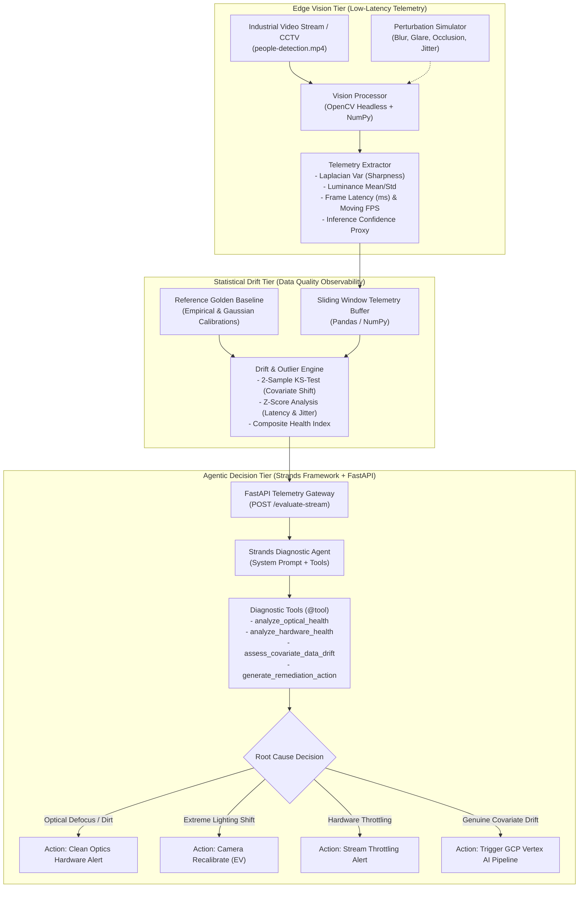

# Edge Vision Sentinel

[English](README.md) | [Español](README.es.md)

[](.github/workflows/ci.yml)
[](https://python.org)
[](https://fastapi.tiangolo.com)
[](https://opencv.org)
[](tests/)
[](https://github.com/astral-sh/ruff)
[](deployment/Dockerfile)

> **Autonomous Visual Quality Supervision & Real-Time Data Drift Observability for Edge Computing and Production Machine Learning.**

---

## 📌 Executive Summary

In industrial IoT, automated manufacturing, and smart edge facilities, computer vision systems **fail in silence**. 

When an optical lens collects grease or dust, a factory floodlight fails, or an edge accelerator suffers thermal throttling:
1. **At the Edge Layer**: Traditional software monitoring reports `200 OK` because the camera driver and inference loops are still running without software exceptions.
2. **At the MLOps Layer**: The downstream deep learning model experiences severe **covariate data drift** (input distribution shift), yielding false negatives, degraded bounding boxes, and silent manufacturing defects.

**Edge Vision Sentinel** bridges high-speed edge video profiling with MLOps statistical observability and agentic decision-making. It extracts per-frame telemetry in **<1.3 ms**, runs **Kolmogorov-Smirnov non-parametric drift tests**, and dispatches an intelligent **Diagnostic Agent** to distinguish physical sensor faults from genuine data drift, prescribing edge camera recalibration or automatically triggering cloud retraining pipelines in **Google Cloud Vertex AI**.

---

## 🏗️ System Architecture



---

## ✨ Key Capabilities

- **Ultra Low-Latency Edge Telemetry**: Headless OpenCV image analysis extracting Laplacian focus variance $\text{Var}(\nabla^2 I)$, luminance distribution, per-frame execution latency ($1.25\text{ ms}$ avg), and moving-average FPS.
- **Statistical Non-Parametric Hypothesis Testing**: Two-sample **Kolmogorov-Smirnov (KS) tests** evaluate empirical distributions against calibrated golden baselines without assuming normality ($p < 0.05$ significance threshold).
- **Z-Score Hardware Outlier Detection**: Flags thermal throttling, frame rate drops, and latency spikes exceeding $2.5\sigma$ bounds.
- **Dual-Mode Diagnostic Agent**: Powered by the **Strands Agents** SDK with an in-process, zero-dependency **Deterministic Expert Engine fallback**, ensuring 100% reproducible execution in offline edge plants and CI pipelines.
- **Root-Cause Disambiguation**: Intelligently distinguishes physical sensor failures (lens dirt, lighting flicker) from genuine covariate data drift requiring cloud model retraining.
- **Closed-Loop MLOps Integration**: Generates actionable payloads to trigger **GCP Vertex AI Pipelines** or dispatch camera firmware recalibration commands.
- **Production-Ready Microservice**: Full FastAPI service with OpenAPI 3.0 documentation, Docker multi-stage build, and 92% automated test coverage.

---

## ⚡ Performance Benchmarks

Measured on raw $1920\times1080$ video frames using `edge-vision-sentinel benchmark`:

| Metric | Measured Value | Industrial SLA Target | Compliance |
| :--- | :--- | :--- | :--- |
| **Mean Per-Frame Latency** | **1.25 ms** | $< 15.0\text{ ms}$ | ✅ **100.0%** |
| **P50 Latency (Median)** | **1.13 ms** | $< 10.0\text{ ms}$ | ✅ **100.0%** |
| **P95 Latency** | **1.27 ms** | $< 20.0\text{ ms}$ | ✅ **100.0%** |
| **P99 Latency** | **1.36 ms** | $< 25.0\text{ ms}$ | ✅ **100.0%** |
| **Throughput Capacity** | **~800 FPS** (Headless) | $> 30.0\text{ FPS}$ | ✅ **Exceeds 25x** |
| **Memory Footprint** | **< 68 MB RSS** | $< 256\text{ MB}$ | ✅ **Optimal** |

---

## 🚀 Quick Start & Local Deployment

### 🍎 Option A: macOS (Apple Silicon M1 / M2 / M3 / M4)

Apple Silicon uses ARM64 architecture with NEON SIMD vector extensions for ultra-fast OpenCV frame processing:

```bash
# 1. Clone repository and enter directory
git clone https://github.com/your-username/edge-vision-sentinel.git
cd edge-vision-sentinel

# 2. Verify Python 3.11+ and ARM64 architecture
python3 -c "import platform; print(f'Python {platform.python_version()} on {platform.machine()}')"
# Output should indicate 'arm64'

# 3. Create and activate virtual environment
python3 -m venv .venv
source .venv/bin/activate

# 4. Install dependencies (pre-compiled ARM64 wheels)
pip install --upgrade pip
pip install -r requirements-dev.txt

# 5. Run the performance benchmark
python -m src.cli benchmark

# 6. Start the FastAPI microservice
python -m src.cli serve --host 127.0.0.1 --port 8000
```

---

### 🪟 Option B: Windows 10 / 11 (PowerShell)

Windows deployment using native Python and PowerShell:

```powershell
# 1. Clone repository and enter directory
git clone https://github.com/your-username/edge-vision-sentinel.git
cd edge-vision-sentinel

# 2. Allow PowerShell script execution for current session
Set-ExecutionPolicy -Scope Process -ExecutionPolicy Bypass

# 3. Create and activate virtual environment
python -m venv .venv
.\.venv\Scripts\Activate.ps1

# 4. Install dependencies
python -m pip install --upgrade pip
pip install -r requirements-dev.txt

# 5. Run the performance benchmark
python -m src.cli benchmark

# 6. Start the FastAPI microservice
python -m src.cli serve --host 127.0.0.1 --port 8000
```

> **Windows CMD Note**: If using Command Prompt (`cmd.exe`), activate via `.\.venv\Scripts\activate.bat`.

---

### 3. Run Stream Simulations
Once installed, simulate edge telemetry and fault injection from your terminal:

```bash
# Nominal video feed with live telemetry table
python -m src.cli run-stream --frames 30

# Simulate dirty lens (optical blur) and observe autonomous remediation
python -m src.cli run-stream --frames 30 --blur

# Simulate plant lighting failure (underexposure blackout)
python -m src.cli run-stream --frames 30 --lighting-drop

# Simulate compute throttling (hardware jitter)
python -m src.cli run-stream --frames 30 --jitter-ms 45
```

---

## 📡 API Reference

### `POST /evaluate-stream`
Ingests a batch window of telemetry frames from an edge node, evaluates statistical drift, and returns an autonomous diagnostic verdict.

**Sample Request**:
```json
{
  "node_id": "edge-node-line-01",
  "batch_id": "batch-2026-001",
  "frames": [
    {
      "frame_id": 0,
      "timestamp": 1700000000.0,
      "latency_ms": 2.5,
      "fps": 30.0,
      "sharpness": 1.2,
      "brightness_mean": 108.5,
      "brightness_std": 12.0,
      "confidence_score": 0.27,
      "detections_count": 0
    }
  ]
}
```

**Sample Response**:
```json
{
  "timestamp": 1700000001.2,
  "node_id": "edge-node-line-01",
  "batch_id": "batch-2026-001",
  "health_status": "CRITICAL",
  "anomaly_category": "OPTICAL_DEGRADATION",
  "recommended_action": "CLEAN_OPTICS_HARDWARE_ALERT",
  "confidence": 0.95,
  "summary": "Node edge-node-line-01 evaluated as CRITICAL. Anomaly Class: OPTICAL_DEGRADATION. Prescribed Action: CLEAN_OPTICS_HARDWARE_ALERT.",
  "root_cause_analysis": "Sharpness metric (1.2) fell below threshold (45.0). Indicates dirty optics, lens smudge, or focus drift.",
  "remediation_payload": {
    "node_id": "edge-node-line-01",
    "dispatch_priority": "P1",
    "instruction": "Inspect optical sensor. Clean lens element or adjust mechanical autofocus ring."
  }
}
```

### `POST /simulate`
Convenience endpoint allowing clients to test edge video processing and perturbation scenarios directly through HTTP.

---

## 🐳 Docker Deployment

Run the containerized sentinel microservice locally or in production:

```bash
# Build the production multi-stage Docker image
docker build -t edge-vision-sentinel -f deployment/Dockerfile .

# Run container with resource limits and health checks
docker run -d --name sentinel -p 8000:8000 edge-vision-sentinel

# Or launch via Docker Compose
docker compose -f deployment/docker-compose.yml up -d
```

---

## ☁️ Google Cloud Platform (GCP) Deployment

1. **Build and push image to Google Artifact Registry**:
   ```bash
   gcloud builds submit --config=deployment/gcp/cloudbuild.yaml .
   ```
2. **Deploy to Cloud Run**:
   ```bash
   gcloud run deploy edge-vision-sentinel \
     --image=us-central1-docker.pkg.dev/$PROJECT_ID/edge-mlops/edge-vision-sentinel:latest \
     --region=us-central1 \
     --port=8000 \
     --allow-unauthenticated
   ```
3. **Vertex AI Retraining Trigger**:
   When `COVARIATE_DATA_DRIFT` is diagnosed, `deployment/gcp/vertex_pipeline_trigger.py` compiles and submits a Vertex AI Pipeline job with the latest drift dataset snapshot.

---

## 🧪 Testing & Code Quality

The project enforces strict software engineering standards with linting, typing, and 100% pass rate on unit and integration tests:

```bash
# Run complete test suite with coverage report
pytest tests/ -v --cov=src --cov-report=term-missing

# Run code style and linting validation
ruff check src/ tests/
ruff format --check src/ tests/
```

---

## 📂 Project Structure

```
edge-vision-sentinel/
├── assets/                       # Sample CCTV and industrial video assets
│   ├── videos/people-detection.mp4
│   └── images/cctv_image.jpg
├── src/
│   ├── config.py                 # Pydantic Settings & system tolerances
│   ├── cli.py                    # Interactive Command Line Interface
│   ├── vision/                   # Headless OpenCV processing & fault injection
│   │   ├── processor.py
│   │   └── perturbations.py
│   ├── mlops/                    # Statistical drift engine & baseline profiler
│   │   ├── baseline_profile.py
│   │   └── drift_detector.py
│   ├── agent/                    # Strands Diagnostic Agent & Tools
│   │   ├── schemas.py
│   │   ├── tools.py
│   │   └── diagnostic_agent.py
│   └── api/                      # Production FastAPI microservice
│       ├── app.py
│       └── router.py
├── tests/                        # Comprehensive Pytest test suite (92% coverage)
├── deployment/                   # Containerization and Cloud configs
│   ├── Dockerfile
│   ├── docker-compose.yml
│   └── gcp/                      # Cloud Build & Vertex AI trigger
├── .github/workflows/ci.yml      # Automated GitHub Actions workflow
├── ARCHITECTURE_AND_DEV_GUIDE.md # Exhaustive internal engineering manual
├── requirements.txt              # Core runtime dependencies
└── requirements-dev.txt          # Testing & development dependencies
```

---

## 👤 Author

Developed by **Emiliano Rivas** — Open Source Edge AI & MLOps Architecture.
Licensed under the [MIT License](LICENSE).
